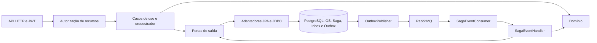
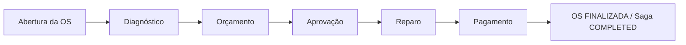
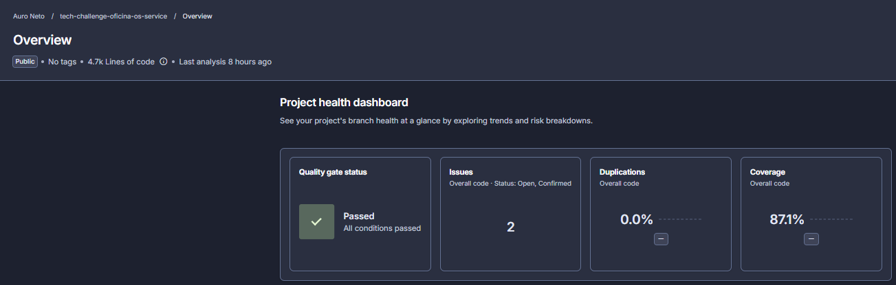

# Oficina — OS Service

[](https://sonarcloud.io/summary/new_code?id=AuroNet0_tech-challenge-oficina-os-service)
[](https://sonarcloud.io/summary/new_code?id=AuroNet0_tech-challenge-oficina-os-service)

O OS Service mantém clientes, veículos, filiais e ordens de serviço da oficina.<br>
É o orquestrador da Saga de diagnóstico, orçamento, aprovação, reparo e pagamento.<br>
Persiste o estado da OS, histórico, Saga, Inbox e Outbox em PostgreSQL e integra comandos e eventos via RabbitMQ.<br>
A API usa JWT e autorização por capacidade, filial e atribuição à OS.

## 2. Arquitetura do serviço

Java 21 e Spring Boot 4.1.1, conforme o [pom.xml](pom.xml). O domínio fica separado dos adaptadores HTTP, JPA e RabbitMQ.



Pacote raiz: `com.oficina.os`.

| Pacote | Responsabilidade |
| --- | --- |
| `domain`, `domain.validation` | Entidades, estados, regras e validação |
| `application.authorization` | Identidade corrente, capacidades, escopo e associações entre filiais |
| `application.usecase`, `application.exception` | Casos de uso e erros de aplicação |
| `application.saga` | Orquestração, máquina de estados e serialização de mensagens |
| `application.port.in`, `application.port.out` | Comandos de entrada e contratos de saída |
| `infrastructure.web` | Controllers, requests, responses e tratamento de erros |
| `infrastructure.persistence` | Entidades/repositórios JPA e adaptadores de persistência, inclusive JDBC |
| `infrastructure.messaging` | Topologia RabbitMQ, consumidor e publisher da Outbox |
| `infrastructure.config`, `infrastructure.security`, `infrastructure.identity` | Configuração, JWT e consulta de vínculo ao Auth |

## 3. API e autenticação

A matriz abaixo combina os controllers com `SecurityConfig`. Papéis são condições iniciais: capacidades e escopo também são verificados na aplicação. Detalhes em [autorização por recurso](docs/security/os-authorization-8.3.2-b.md).

| Método | Caminho | Papel (role) exigido |
| --- | --- | --- |
| POST | `/api/v1/clientes?filialId={uuid}` | `ATENDENTE` |
| GET | `/api/v1/clientes` | `ATENDENTE` |
| GET | `/api/v1/clientes/{id}` | `ATENDENTE` |
| PUT | `/api/v1/clientes/{clienteId}/filiais/{filialId}` | `ATENDENTE` |
| POST | `/api/v1/veiculos?filialId={uuid}` | `ATENDENTE` |
| GET | `/api/v1/veiculos?clienteId={uuid}` | `CLIENTE` ou `ATENDENTE` |
| GET | `/api/v1/veiculos/{id}` | `CLIENTE` ou `ATENDENTE` |
| PUT | `/api/v1/veiculos/{veiculoId}/filiais/{filialId}` | `ATENDENTE` |
| POST | `/api/v1/filiais` | `GERENTE` |
| GET | `/api/v1/filiais` | `ATENDENTE` ou `GERENTE` |
| GET | `/api/v1/filiais/{id}` | `ATENDENTE` ou `GERENTE` |
| POST | `/api/v1/ordens-servico` | `ATENDENTE` |
| GET | `/api/v1/ordens-servico` | `CLIENTE`, `ATENDENTE` ou `GERENTE` |
| GET | `/api/v1/ordens-servico/{id}` | `CLIENTE`, `ATENDENTE` ou `GERENTE` |
| GET | `/api/v1/ordens-servico/{id}/historico` | `CLIENTE`, `ATENDENTE` ou `GERENTE` |
| GET | `/api/v1/ordens-servico/{id}/saga` | `GERENTE` |
| GET | `/api/v1/ordens-servico/{id}/operacional` | `MECANICO` |
| GET | `/api/v1/ordens-servico/{id}/veiculo-operacional` | `MECANICO` |
| POST | `/internal/technical-authorization` | JWT autenticado na regra HTTP; decisão positiva exige `MECANICO`, capacidade e atribuição |
| POST | `/internal/financial-authorization` | JWT autenticado na regra HTTP; decisão positiva exige `CLIENTE` com vínculo ou, para `READ`, `ATENDENTE`/`GERENTE` com `OS_READ` |
| GET | `/actuator/health` | Público |
| GET | `/actuator/health/liveness` | Público |
| GET | `/actuator/health/readiness` | Público |

Os endpoints internos também exigem HTTPS e certificado de cliente com subject exato `CN=execution-service` ou `CN=billing-service`, respectivamente, e identidade do corpo igual à do JWT. Retornam decisões de autorização; não avançam a Saga.

Abertura exige `OS_OPEN` e cliente/veículo associados à filial. Consulta da Saga exige `SAGA_INSPECT`; as projeções do mecânico exigem atribuições individuais. `GERENTE` não herda outros papéis. Associações entre filiais exigem leitura autorizada na origem e capacidades `CLIENT_ASSOCIATE`/`VEHICLE_ASSOCIATE` no destino; os PUTs retornam 204, inclusive nas repetições aceitas.

Swagger/OpenAPI não é publicado por política: `application.yml` desabilita ambos por padrão e `SecurityConfig` nega rotas não permitidas. Ativar `OPENAPI_ENABLED` isoladamente não libera acesso.

O cliente envia `Authorization: Bearer <JWT>`. `AuthJwtDecoder` valida assinatura RS256 pelo JWKS de `AUTH_JWKS_URI`, igualdade exata de `iss` com `AUTH_JWT_ISSUER` e array `aud` contendo `AUTH_JWT_AUDIENCE`. Valores de issuer/audience de produção: não identificados neste repositório.

O header admite somente `alg=RS256`, `typ=JWT` e `kid` não vazio. `sub` e `jti` devem ser UUIDs canônicos; `iat`, `nbf` e `exp` são inteiros, com `nbf=iat`, emissão não futura, expiração válida e duração máxima de 900 segundos, sem tolerância de relógio. `roles` é array sem duplicatas limitado a `CLIENTE`, `ATENDENTE`, `MECANICO` e `GERENTE`; array vazio é aceito sem conceder papéis. Apenas esse claim gera authorities `ROLE_`.

Sem o perfil `mtls`, `UnavailableClientAccessAdapter` mantém indisponível a autorização que depende de vínculo com o Auth. Com `mtls`, `MtlsClientAccessAdapter` consulta o endpoint HTTPS configurado em `oficina.internal.auth-uri`; falhas não concedem acesso. A existência desse adaptador não comprova integração implantada.

## 4. Dados

O serviço utiliza banco SQL PostgreSQL, com banco próprio `oficina_os` na configuração local e no Compose: datasource e migrações pertencem ao OS. O isolamento efetivo do banco em produção não é demonstrado pelo workflow.

O Flyway executa [migrações versionadas](src/main/resources/db/migration/V1__bootstrap_schema.sql) de `classpath:db/migration`; Hibernate usa `ddl-auto=validate`.

| Migração | Conteúdo |
| --- | --- |
| V1 | `os_service_bootstrap` |
| V2 | `clientes`, `veiculos`, `filiais`, `ordens_servico`, `historico_status` |
| V3 | `outbox_events` |
| V4 | `saga_instances` e `inbox_messages`; uma Saga por OS |
| V5 | Grants operacionais/administrativos, atribuições de mecânicos e escopo cadastral por filial |
| V6 | Capacidades de associação e `branch_association_audit` |
| V7 | Capacidades de diagnóstico, reparo e histórico em `mechanic_assignments` |

## 5. Mensageria

Topologia declarada em `RabbitMessagingConfig`, com nomes padrão de [application.yml](src/main/resources/application.yml). Contratos e limites em [eventos e comandos](docs/events.md).

| Elemento | Nome / binding |
| --- | --- |
| Exchange topic durável de comandos | `oficina.commands` |
| Fila durável de diagnóstico declarada pelo OS | `execution.diagnostic.start`, binding `diagnostic.start.v1` |
| Exchange topic durável de eventos | `oficina.events` |
| Fila durável consumida pelo OS | `os.saga.events`, binding `#.v1` |
| Dead-letter exchange topic durável | `oficina.events.dlx` |
| DLQ durável | `os.saga.events.dlq`, binding `saga.events.dead` |

O OS publica comandos `diagnostic.start.v1`, `quote.create.v1`, `repair.start.v1`, `repair.cancel.v1` e `payment.request.v1`. A routing key de saída é o `eventType`. Não foi identificada publicação de eventos de negócio pelo OS.

Consome `diagnostic.started.v1`, `diagnostic.completed.v1`, `diagnostic.failed.v1`, `quote.created.v1`, `quote.creation-failed.v1`, `quote.approved.v1`, `quote.rejected.v1`, `repair.started.v1`, `repair.completed.v1`, `repair.failed.v1`, `repair.cancelled.v1`, `repair.cancellation-failed.v1`, `payment.confirmed.v1` e `payment.failed.v1`.

A abertura grava OS, histórico, Saga e Outbox na mesma transação. Eventos recebidos atualizam Inbox, OS, histórico, Saga e comandos derivados transacionalmente. A Inbox deduplica por `eventId`; mensagens já `PROCESSED` ou `REJECTED` são ignoradas.

O publisher usa lease persistido, `FOR UPDATE SKIP LOCKED`, mensagens persistentes, `mandatory`, confirms e verificação de retornos não roteáveis. Padrões: lote de 10, intervalo de 5 s, lease de 1 min, até 5 tentativas e backoff exponencial de 10 s até 5 min. Esgotadas as tentativas, a Outbox fica `FAILED`, sem envio automático à DLQ.

A entrega admite duplicatas (at-least-once): confirmação no broker seguida de falha na atualização local pode causar republicação. A DLQ recebe mensagens dead-lettered pelo broker; não há política explícita de retry limitado do listener, fila de retry ou redrive automático neste repositório. Rejeições de negócio tratadas pelo handler ficam `REJECTED` na Inbox e não vão automaticamente à DLQ.

## 6. Papel na Saga e compensação

O OS é o **orquestrador**: `OrdemServicoSagaOrchestrator` inicia a instância e `SagaEventHandler` coordena respostas e comandos. Detalhes em [Saga](docs/saga.md).



O fluxo começa em `WAITING_DIAGNOSTIC`. Diagnóstico concluído gera `quote.create.v1`; orçamento criado leva a `WAITING_APPROVAL`; aprovação gera `repair.start.v1`; reparo concluído gera `payment.request.v1`; confirmação de pagamento finaliza a OS e a Saga. A OS não passa automaticamente para `ENTREGUE`.

| Falha / resposta | Comportamento do código |
| --- | --- |
| Diagnóstico falhou, criação do orçamento falhou ou orçamento rejeitado | Na etapa correspondente, cancela a OS e termina a Saga em `COMPENSATED` |
| Reparo falhou | Grava `repair.cancel.v1` na Outbox; Saga `COMPENSATING`, com erro registrado; OS não muda nesse tratamento |
| `repair.cancelled.v1` | Saga `COMPENSATED`; OS só é cancelada se estiver `RECEBIDA`, `EM_DIAGNOSTICO` ou `AGUARDANDO_APROVACAO` |
| `repair.cancellation-failed.v1` | Saga `FAILED`, preserva a OS e registra o motivo; requer intervenção operacional, sem endpoint de recuperação identificado |
| Pagamento falhou | OS permanece `AGUARDANDO_PAGAMENTO`, Saga `WAITING_PAYMENT`, erro recuperável registrado; confirmação posterior pode concluir |

A preservação do trabalho físico pelo Execution e sua emissão de `repair.cancellation-failed.v1` para reparo iniciado/concluído não podem ser confirmadas pelo código deste serviço. O OS confirma o contrato de consumo e não desfaz execução física. Também não agenda nova cobrança ao receber falha de pagamento: admite confirmação posterior, mas o mecanismo de nova tentativa no Billing não foi identificado aqui.

### Por que Saga orquestrada

1. A OS representa um fluxo sequencial com estado explícito; um coordenador único torna transições legíveis e testáveis, como exercitado em `SagaEventHandlerTest`.
2. As compensações dependem do estado da OS: cancelar a ordem quando permitido ou solicitar cancelamento de reparo. O OS conhece e valida esse estado.
3. Os contratos do OS separam comandos e respostas de Execution e Billing, permitindo coordenação sem que esses participantes precisem conhecer um ao outro. A ausência de dependências entre suas implementações não é verificável neste repositório.
4. A tabela `saga_instances` concentra status, etapa atual, erro e correlação, consultáveis pela API com autorização específica.
5. Outbox/Inbox transacionais sustentam entrega at-least-once e idempotência. Retry de publicação e DLQ de consumo tratam falhas em pontos distintos; não há garantia de que toda mensagem com falha alcance a DLQ.

Trade-off: o OS é o ponto central de coordenação. Persistência da Saga, Outbox/Inbox, retry de publicação e DLQ mitigam falhas de entrega e processamento, respeitando os limites descritos na seção de mensageria.

## 7. Execução local e testes

Pré-requisitos: Docker com Compose; Java 21 para execução/testes fora do container. Os testes de integração usam Testcontainers com PostgreSQL e RabbitMQ e exigem Docker disponível.

Não há `.env.example`. Antes de executar, configure `AUTH_JWT_ISSUER`, `AUTH_JWT_AUDIENCE` e `AUTH_JWKS_URI` com o emissor e JWKS confiáveis do seu ambiente; são obrigatórios no [compose.yaml](compose.yaml). Configure credenciais via ambiente, sem registrá-las na documentação.

| Grupo | Variáveis |
| --- | --- |
| PostgreSQL | `DB_HOST`, `DB_PORT`, `DB_NAME`, `DB_USERNAME`, `DB_PASSWORD` |
| JWT | `AUTH_JWT_ISSUER`, `AUTH_JWT_AUDIENCE`, `AUTH_JWKS_URI` |
| RabbitMQ | `RABBITMQ_HOST`, `RABBITMQ_PORT`, `RABBITMQ_USERNAME`, `RABBITMQ_PASSWORD`, `RABBITMQ_MANAGEMENT_PORT` |
| Topologia | `RABBITMQ_COMMANDS_EXCHANGE`, `RABBITMQ_EVENTS_EXCHANGE`, `RABBITMQ_DIAGNOSTIC_START_ROUTING_KEY`, `RABBITMQ_DIAGNOSTIC_START_QUEUE`, `RABBITMQ_SAGA_EVENTS_QUEUE`, `RABBITMQ_SAGA_EVENTS_DLQ`, `RABBITMQ_CONFIRM_TIMEOUT` |
| Outbox | `OUTBOX_PUBLISHER_ENABLED`, `OUTBOX_PUBLISHER_BATCH_SIZE`, `OUTBOX_PUBLISHER_FIXED_DELAY`, `OUTBOX_PUBLISHER_LEASE_DURATION`, `OUTBOX_PUBLISHER_MAX_ATTEMPTS`, `OUTBOX_PUBLISHER_INITIAL_BACKOFF`, `OUTBOX_PUBLISHER_MAX_BACKOFF` |

Compose repassa explicitamente apenas parte dessas variáveis, conforme seu bloco `environment`; variáveis adicionais de `application.yml` precisam ser fornecidas ao processo da aplicação. A porta de gerenciamento do RabbitMQ é configuração exclusiva do Compose.

```bash
docker compose up --build
docker compose down
```

Compose inicia PostgreSQL, RabbitMQ e API; a dependência de saúde declarada para a API é apenas PostgreSQL. API em `http://localhost:8080`, PostgreSQL em `localhost:5432`, AMQP em `localhost:5672` e gerenciamento RabbitMQ em `http://localhost:15672` por padrão.

Para executar a aplicação no host, inicie as dependências e configure as variáveis JWT no mesmo terminal:

```bash
docker compose up -d postgres rabbitmq
./mvnw spring-boot:run
```

O Compose resolve as variáveis JWT obrigatórias mesmo ao selecionar as dependências. Para testes:

```bash
./mvnw clean verify
```

No PowerShell, use `.\mvnw.cmd spring-boot:run` ou `.\mvnw.cmd clean verify`. As suítes incluem domínio, autorização JWT, Saga, persistência, rollback, migrações e mensageria. Não há resultado de nova execução de testes associado a esta revisão documental.

## 8. Qualidade e cobertura

O [pom.xml](pom.xml) aplica JaCoCo em `verify`: elemento `BUNDLE`, contador `LINE`, métrica `COVEREDRATIO`, mínimo **0,80**. A exclusão configurada é `OsApplication.class`. Relatórios são gerados em `target/site/jacoco/index.html` e `target/site/jacoco/jacoco.xml`.

Cobertura SonarCloud informada para a análise de **13/11/2026: 87,1%**. Esse dado foi fornecido para esta revisão; não há evidência local identificada dessa análise. Consulte o [projeto no SonarCloud](https://sonarcloud.io/summary/new_code?id=AuroNet0_tech-challenge-oficina-os-service); os badges mostram o estado remoto.



A imagem solicitada ainda não existe no repositório; o destino acima permanece pendente, pois somente arquivos Markdown foram autorizados nesta revisão.

## 9. CI/CD

O workflow [Productive build verification](.github/workflows/ci.yml) executa em pull requests e pushes para `main`/`homolog`, além de execução manual.

O job `verify`:

1. Obtém a revisão exata do OS e uma revisão fixa da infraestrutura para o verificador de segredos; prepara Java 21.
2. Testa o verificador Python e executa [scripts/ci/verify.py](scripts/ci/verify.py): varredura de segredos nas fontes, Maven `clean verify`, gate JaCoCo e conferência de relatórios sem falhas, erros ou testes ignorados.
3. Constrói imagem `linux/amd64`, verifica usuário `10001:10001`, entrypoint, `SIGTERM` e healthcheck. Executa runtime com PostgreSQL/RabbitMQ temporários, valida Java 21, probes `UP` e encerramento por sinal.
4. Analisa no SonarCloud usando o XML JaCoCo. A espera bloqueante pelo Quality Gate (`sonar.qualitygate.wait=true`) ocorre somente em push na `main`; a análise ocorre também nos demais disparos. Ausência de `SONAR_TOKEN` falha o passo.
5. Publica relatórios JSON sanitizados como artefatos, inclusive na falha.

O job `deploy` depende de `verify` e executa somente em push na `main`, sem cancelar um deploy já em andamento:

1. Assume o papel AWS por OIDC, com `vars.AWS_ROLE_ARN`.
2. Faz preflight de EKS/ECR. Cluster ou repositório inexistente gera `deploy=skip`; ambiente desligado só é tratado assim quando esses recursos estão ausentes. Outros erros falham o job.
3. Reutiliza a imagem existente para `github.sha` ou constrói e envia a tag desse SHA ao ECR. O workflow não sobrescreve a tag já encontrada; a política de imutabilidade do repositório ECR não é configurada por ele.
4. Obtém e valida o digest SHA-256, atualiza o kubeconfig e executa `kubectl set image` no Deployment usando referência por digest.
5. Aguarda `kubectl rollout status` com timeout de 300 s. Na falha, coleta descrição/logs e falha o job; não há rollback automático identificado.

| Configuração do GitHub Actions | Uso |
| --- | --- |
| Secret `SONAR_TOKEN` | Análise SonarCloud |
| Variável `AWS_ROLE_ARN` | Papel AWS assumido no deploy |
| `GITHUB_TOKEN` fornecido pelo GitHub | Análise SonarCloud |

Região, cluster, namespace, ECR, Deployment e container são definidos no próprio workflow. O ambiente AWS deve permitir as operações EKS/ECR e a atualização do Deployment; o workflow não provisiona esses recursos.

## 10. Implantação

O destino de implantação é EKS, com recursos gerados pelo stack `platform` do repositório [tech-challenge-oficina-k8s-infra](https://github.com/AuroNet0/tech-challenge-oficina-k8s-infra), referido pelo CI. O workflow atualiza a imagem de um Deployment previamente provisionado; sua presença e disponibilidade em produção não foram verificadas nesta revisão.

| Item | Valor confirmado |
| --- | --- |
| Região AWS | `us-east-1` |
| Cluster EKS | `tc-oficina-p4-demo-a` |
| Namespace | `tc-oficina-p4-demo-a` |
| Deployment / container | `os-service` / `os-service` |
| Repositório ECR | `tc-oficina-p4-demo-a-os` |
| Referência de implantação | Registry da conta obtida por STS, repositório ECR e digest `sha256` |
| Porta exposta pelo Dockerfile / Compose | `8080` |
| Healthcheck do Dockerfile | `http://127.0.0.1:8080/actuator/health/readiness` |
| Endpoints de saúde | `/actuator/health`, `/actuator/health/liveness`, `/actuator/health/readiness` |

O [Dockerfile](Dockerfile) usa build e runtime Java 21 em etapas separadas, usuário sem privilégios `10001:10001` e `SIGTERM`. O `ci.yml` não define porta do Deployment, TLS ou probes de EKS; a porta 8080 acima descreve a imagem/local, não comprova a configuração aplicada no cluster.

## 11. Estrutura do repositório

| Caminho | Conteúdo |
| --- | --- |
| `src/main/java/com/oficina/os` | Domínio, aplicação e infraestrutura |
| `src/main/resources` | Configuração e migrações Flyway |
| `src/test` | Testes e configuração de testes |
| `docs` | Saga, eventos e autorização |
| `scripts/ci` | Verificador de CI e seus testes |
| `.github/workflows` | Workflow de verificação e deploy |
| `.mvn`, `mvnw`, `mvnw.cmd` | Maven Wrapper |
| `compose.yaml`, `Dockerfile` | Execução local e imagem |

## Pendências, divergências e links

### Afirmações não confirmadas

- Preservação e recusa de cancelamento de reparo iniciado/concluído na implementação do Execution; o OS apenas consome os eventos previstos.
- Nova tentativa de pagamento no Billing: o OS mantém o estado recuperável, mas não publica novo pedido ao receber `payment.failed.v1`.
- Ausência de dependências entre as implementações de Execution e Billing; verificam-se aqui somente os contratos do OS.
- Valores produtivos de issuer/audience, banco efetivamente isolado, ambiente EKS em execução e integração Auth implantada.
- Política de imutabilidade efetiva do ECR e porta/probes aplicadas no Deployment: não definidas no `ci.yml`/`Dockerfile` como configuração de cluster.
- Evidência local dos 87,1% do SonarCloud em 13/11/2026 e imagem `docs/img/sonarcloud.png`, ausente.

### Divergências dos documentos anteriores

- O README afirmava que o CI não publicava imagens nem fazia deploy; o workflow atual possui job `deploy`.
- A ausência de Billing/Execution e de consumidores externos era afirmada sem base no código do OS; foi substituída pelo limite de verificação dos participantes externos.
- A declaração de `execution.diagnostic.start` continua no código sem restrição de perfil; o texto antigo a descrevia como exclusiva de desenvolvimento/testes.
- A documentação de segurança tratava a consulta ao Auth como sempre indisponível e não cobria o perfil `mtls`, os endpoints internos nem a V7. Foi acrescentado o estado atual com correção dessas afirmações.
- Os resultados históricos de JaCoCo/testes dos docs não são apresentados como cobertura SonarCloud atual nem como nova execução.
- Retry de publicação, rejeição na Inbox e dead-lettering são mecanismos distintos; não foi identificado envio de toda falha à DLQ nem novo comando de pagamento automático.

### Links relativos e validação

- O link quebrado `docs/ci-os-service.md` foi substituído pela seção [CI/CD](#9-cicd) deste README.
- Referências entre docs usam [Saga](docs/saga.md), [eventos](docs/events.md) e [autorização](docs/security/os-authorization-8.3.2-b.md); os links internos desses documentos consideram sua própria pasta.
- O destino da imagem `docs/img/sonarcloud.png` não existe e permanece como única pendência de arquivo nos links relativos desta revisão.
