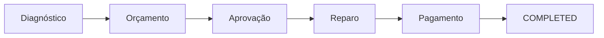

# Saga orquestrada da ordem de serviço

O OS Service é o orquestrador. `OrdemServicoSagaOrchestrator` cria a instância; `SagaEventHandler` processa eventos e grava os próximos comandos. A abertura da OS persiste ordem, histórico inicial, Saga e `diagnostic.start.v1` na mesma transação PostgreSQL.

A tabela `saga_instances` possui uma instância por OS, com status, etapa atual, correlação, erro, versão e datas. Consulte também [eventos e comandos](events.md) e [README](../README.md#6-papel-na-saga-e-compensação).

## Estados e fluxo

Status modelados: `STARTED`, `WAITING_DIAGNOSTIC`, `WAITING_QUOTE`, `WAITING_APPROVAL`, `WAITING_REPAIR`, `WAITING_PAYMENT`, `COMPENSATING`, `COMPLETED`, `COMPENSATED`, `FAILED`. A criação inicia diretamente em `WAITING_DIAGNOSTIC`.

Etapas: `DIAGNOSTIC`, `QUOTE`, `APPROVAL`, `REPAIR`, `PAYMENT`, `COMPENSATION`, `DONE`. A validação exige status e etapa compatíveis; estados terminais não aceitam mudanças.



| Entrada | Efeito na OS | Efeito na Saga / comando |
| --- | --- | --- |
| Abertura | `RECEBIDA` e histórico inicial | `WAITING_DIAGNOSTIC`; `diagnostic.start.v1` |
| `diagnostic.started.v1` | `EM_DIAGNOSTICO`; se já nesse estado, não repete a transição | Permanece em diagnóstico |
| `diagnostic.completed.v1` | Exige `EM_DIAGNOSTICO`; não altera o status | Valida itens, grava `quote.create.v1`; `WAITING_QUOTE` |
| `quote.created.v1` | `AGUARDANDO_APROVACAO` | Exige `quoteId`; `WAITING_APPROVAL` |
| `quote.approved.v1` | Não altera o status | `repair.start.v1`; `WAITING_REPAIR` |
| `repair.started.v1` | `EM_EXECUCAO` | Permanece aguardando reparo |
| `repair.completed.v1` | `AGUARDANDO_PAGAMENTO` | Exige `repairId`, grava `payment.request.v1`; `WAITING_PAYMENT` |
| `payment.confirmed.v1` | `FINALIZADA` | Exige `paymentId`; `COMPLETED`, etapa `DONE` |

Não há transição automática para `ENTREGUE` nem endpoint HTTP de avanço manual de status.

## Falhas e compensações

| Evento | Condição | Resultado |
| --- | --- | --- |
| `diagnostic.failed.v1` | `WAITING_DIAGNOSTIC` / `DIAGNOSTIC` | Cancela OS; Saga `COMPENSATED` |
| `quote.creation-failed.v1` | `WAITING_QUOTE` / `QUOTE` | Cancela OS; Saga `COMPENSATED` |
| `quote.rejected.v1` | `WAITING_APPROVAL` / `APPROVAL` | Cancela OS; Saga `COMPENSATED` |
| `repair.failed.v1` | `WAITING_REPAIR` / `REPAIR` | Outbox `repair.cancel.v1` com motivo; Saga `COMPENSATING` / `COMPENSATION`, com erro; não altera OS |
| `repair.cancelled.v1` | `COMPENSATING` / `COMPENSATION` | Saga `COMPENSATED`; cancela OS somente em `RECEBIDA`, `EM_DIAGNOSTICO` ou `AGUARDANDO_APROVACAO` |
| `repair.cancellation-failed.v1` | `COMPENSATING` / `COMPENSATION` | Saga `FAILED`, com motivo; OS preservada |
| `payment.failed.v1` | `WAITING_PAYMENT` / `PAYMENT` e OS `AGUARDANDO_PAGAMENTO` | Apenas registra erro recuperável; mantém os estados |

A compensação de reparo depende de resposta externa; não há rollback de trabalho físico no OS. Se chegar `repair.cancelled.v1` quando a OS já está `EM_EXECUCAO`, o handler preserva esse status e conclui a Saga como `COMPENSATED`. Se chegar `repair.cancellation-failed.v1`, termina em `FAILED`, sem recuperação automática ou endpoint de intervenção identificado.

A regra de o Execution preservar reparo iniciado/concluído e emitir `repair.cancellation-failed.v1` não é verificável neste repositório. O contrato aceito pelo OS está confirmado; o comportamento do produtor requer conferência no respectivo serviço.

Falha de pagamento admite confirmação posterior `payment.confirmed.v1`, sem cancelar a OS ou desfazer reparo. O handler não publica outro `payment.request.v1` nessa falha. A implementação de nova tentativa de cobrança no Billing não foi identificada aqui.

## Por que Saga orquestrada

1. O processo da OS é sequencial e tem estado explícito. O coordenador concentra transições verificáveis em testes.
2. Compensações dependem do estado conhecido pelo OS: cancelar a ordem ou solicitar cancelamento de reparo.
3. Os comandos e eventos do OS permitem coordenar Execution e Billing sem exigir comunicação direta entre eles. Suas dependências internas não são verificáveis neste repositório.
4. `saga_instances` concentra status, etapa e erro; a consulta HTTP exige `GERENTE` e `SAGA_INSPECT` na filial.
5. Outbox/Inbox transacionais suportam entrega at-least-once com deduplicação. Retry de publicação e DLQ de consumo cobrem falhas distintas, sem garantir DLQ para toda falha.

Trade-off: o OS concentra a coordenação. Persistência da Saga, Outbox/Inbox, retry e DLQ mitigam falhas, com os limites descritos em [mensageria](events.md#entrega-retry-e-dlq).

## Inbox e consistência

`inbox_messages` usa `event_id` como chave primária. O registro existente é bloqueado por `PESSIMISTIC_WRITE`; `PROCESSED` e `REJECTED` são deduplicados. Saga usa versão JPA para concorrência.

O handler valida identificadores obrigatórios, existência da Saga e correspondência da OS. Erros de domínio, argumentos ou recurso inexistente capturados durante o tratamento ficam `REJECTED`; eventos fora da etapa não avançam o fluxo. A desserialização e a validação inicial do envelope ocorrem antes desse bloco de tratamento: suas falhas propagam ao listener.

Inbox, OS, histórico, Saga e Outbox derivada participam da transação do handler. Exceções técnicas não capturadas propagam; a topologia DLQ não implica retry limitado do listener.

## Outbox

Comandos são persistidos antes de publicação. O publisher adquire lote por lease, envia sem manter a transação de aquisição aberta durante a espera pelo broker e atualiza o resultado com condição de correspondência do lease. Confirmação seguida de falha no banco admite republicação com o mesmo identificador.

## Participantes e limites de verificação

O OS integra os contratos de diagnóstico/reparo e orçamento/pagamento, além das autorizações internas para `execution-service` e `billing-service`. A documentação anterior afirmava que esses serviços não existiam; essa afirmação foi removida porque não é demonstrável pelo código deste repositório.

A conclusão de `repair.cancel.v1` depende de `repair.cancelled.v1` ou `repair.cancellation-failed.v1`. A implementação dos consumidores externos e o estado implantado dos participantes não foram identificados neste repositório.

## Testes

```bash
./mvnw clean verify
```

No PowerShell: `.\mvnw.cmd clean verify`. Os testes de integração usam Testcontainers; Docker deve estar disponível.

`SagaEventHandlerTest` verifica fluxo e falhas; `SagaMessageSerializerTest` verifica comandos; `SagaFailureIntegrationTest` verifica rejeição de falhas incompatíveis sem alterar dados de negócio; os testes de rollback/persistência e RabbitMQ verificam os respectivos adaptadores. Esta revisão documental não representa uma nova execução das suítes.
